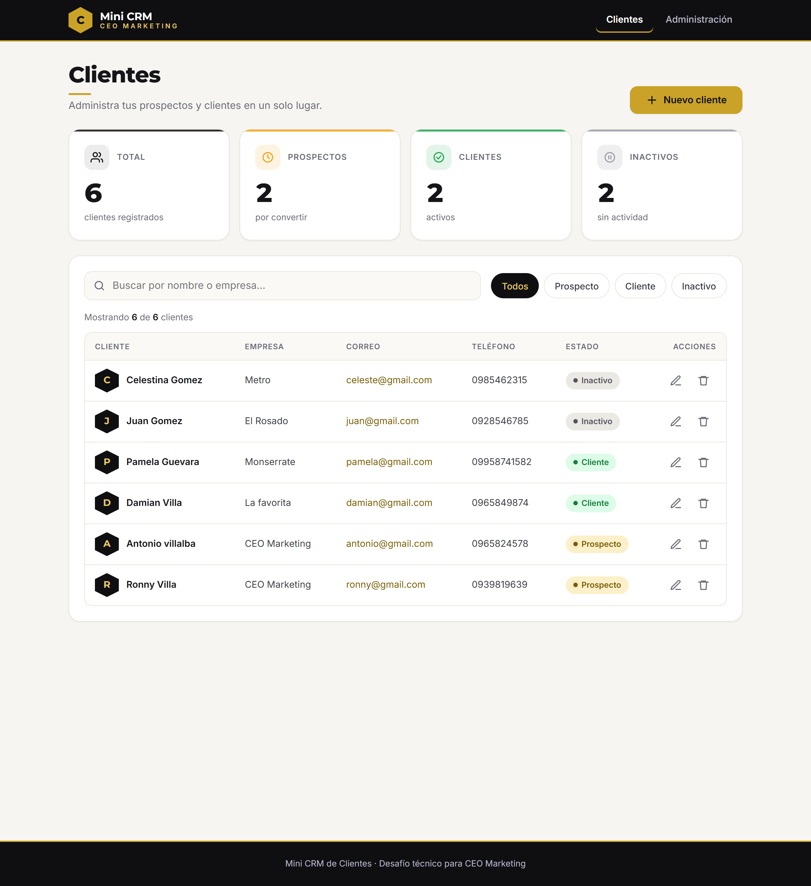
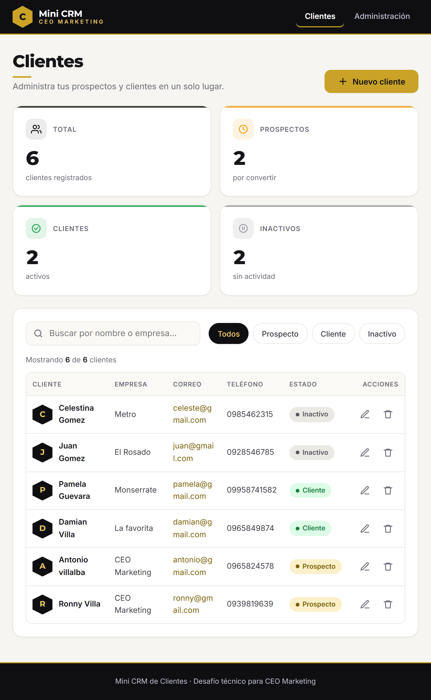
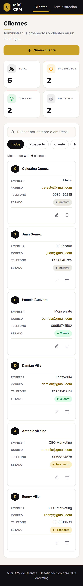
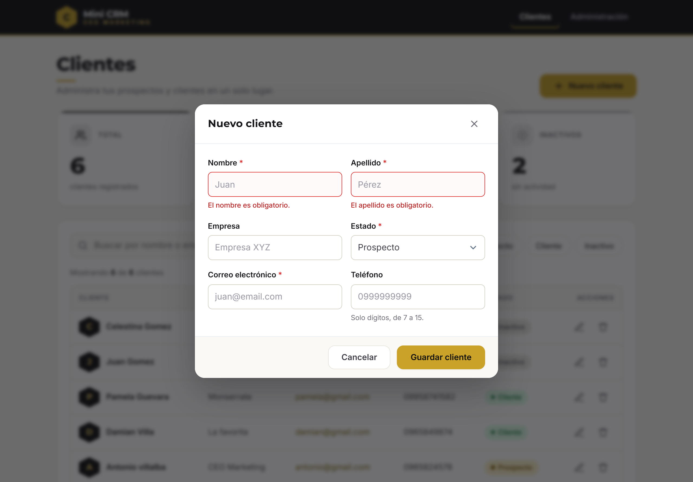

# Mini CRM de Clientes


Aplicación web para registrar, buscar y administrar clientes y prospectos. Desarrollada como **desafío técnico para CEO Marketing** (vacante: Desarrollador/a de Software Junior), con enfoque principal en **frontend** (HTML, CSS y JavaScript vanilla) y un backend complementario en **Django**.

## Capturas

| Escritorio | Tablet | Móvil |
|---|---|---|
|  |  |  |



## Funcionalidades

- [x] Registrar un nuevo cliente (nombre, apellido, empresa, correo, teléfono y estado)
- [x] Listar los clientes existentes con avatar, estado y acciones
- [x] Editar la información de un cliente (modal con datos precargados)
- [x] Eliminar un cliente **con confirmación previa**
- [x] Buscar por nombre, apellido o empresa (búsqueda dinámica con *debounce*)
- [x] Filtrar por estado: Prospecto, Cliente e Inactivo
- [x] Dashboard con contadores animados (total, prospectos, clientes e inactivos)
- [x] Persistencia en base de datos (SQLite)
- [x] Mensajes de éxito, error y validación (notificaciones *toast*)
- [x] Administración desde Django Admin, con tema oscuro propio (negro y dorado), insignias de estado y diseño responsive

## Tecnologías

| Área | Tecnología |
|---|---|
| Frontend | HTML5 semántico, CSS3 (Grid, Flexbox, variables, media queries) y JavaScript vanilla, sin librerías |
| Backend | Python y Django |
| Base de datos | SQLite |
| Servidor | Gunicorn y WhiteNoise (archivos estáticos) |
| Contenedores | Docker y Docker Compose |
| CI | GitHub Actions |
| Control de versiones | Git y GitHub |

## Requisitos previos

- Python 3.12 o superior (probado con 3.13 y 3.14)
- Git
- Docker Desktop (solo si se va a ejecutar con Docker)

## Instalación y ejecución local

### Windows (PowerShell)

```powershell
git clone https://github.com/Ronnyvilla3021/Desafio_Tecnico_CEO_Marketing.git
cd Desafio_Tecnico_CEO_Marketing
python -m venv venv
.\venv\Scripts\Activate.ps1
pip install -r requirements.txt
Copy-Item .env.example .env
python manage.py migrate
python manage.py createsuperuser
python manage.py runserver
```

Si PowerShell bloquea la activación del entorno virtual, ejecutar una vez `Set-ExecutionPolicy -Scope CurrentUser RemoteSigned`.

### macOS / Linux

```bash
git clone https://github.com/Ronnyvilla3021/Desafio_Tecnico_CEO_Marketing.git
cd Desafio_Tecnico_CEO_Marketing
python3 -m venv venv
source venv/bin/activate
pip install -r requirements.txt
cp .env.example .env
python manage.py migrate
python manage.py createsuperuser
python manage.py runserver
```

### Abrir la aplicación

- Aplicación: http://127.0.0.1:8000/
- Django Admin: http://127.0.0.1:8000/admin/ (con el superusuario creado en el paso anterior)

> El archivo `.env.example` trae valores de desarrollo (`DJANGO_DEBUG=True`). Para generar una clave propia:
> `python -c "from django.core.management.utils import get_random_secret_key as k; print(k())"`
>
> En desarrollo puede aparecer el aviso `No directory at: ...staticfiles`. Es normal y no afecta el funcionamiento: la carpeta se crea con `python manage.py collectstatic`.

## Ejecución con Docker

```bash
docker compose up --build
```

La aplicación queda en http://localhost:8000/. Las migraciones se aplican solas al iniciar. Para crear un administrador:

```bash
docker compose exec web python manage.py createsuperuser
```

Para detener los contenedores:

```bash
docker compose down
```

Los datos se guardan en un volumen de Docker (`crm_data`) y **se conservan** entre reinicios. `docker compose down -v` borra también los datos.

Docker Compose usa las variables de un archivo `.env` si existe; si no, usa valores de demostración, por lo que el proyecto se levanta sin configurar nada. Si el puerto 8000 está ocupado, cambiar `"8000:8000"` en `docker-compose.yml`.

## Pruebas automatizadas

```bash
python manage.py test
```

Son **44 pruebas** que cubren:

| Área | Qué se verifica |
|---|---|
| Modelo | Nombre completo, `__str__`, estado por defecto, correo único, teléfono inválido y fechas automáticas |
| Formulario | Longitud mínima de nombre y apellido, campos opcionales, correo en minúsculas, espacios sobrantes y correo duplicado |
| Dashboard | Contadores, búsqueda por nombre, apellido, empresa y nombre completo, filtro por estado y filtros combinados |
| CRUD | Crear, consultar, editar y eliminar, con errores 400, 404 y 405 |
| Admin | Modelo registrado y listado para superusuario |

## Integración continua

El workflow `.github/workflows/ci.yml` se ejecuta en cada **push** y **pull request**:

1. **Revisar y probar Django:** descarga el código, instala Python y dependencias, ejecuta `manage.py check`, verifica que no falten migraciones, recopila los estáticos y corre las 44 pruebas.
2. **Construir imagen Docker:** valida `docker-compose.yml` y construye la imagen (solo si el job anterior pasó).

## Estructura del proyecto

```
.
├── config/                  # Configuración del proyecto Django (settings, urls, wsgi)
├── clients/                 # App principal
│   ├── migrations/
│   ├── admin.py             # Registro en Django Admin
│   ├── forms.py             # Validaciones de backend
│   ├── models.py            # Modelo Client
│   ├── tests.py             # 44 pruebas automatizadas
│   ├── urls.py
│   └── views.py             # Dashboard y CRUD (respuestas JSON)
├── templates/
│   ├── admin/base_site.html # Carga el tema oscuro del Django Admin
│   ├── base.html
│   └── clients/             # client_list.html y modales (_client_modal, _confirm_modal)
├── static/
│   ├── css/styles.css       # Estilos del sitio, organizados por secciones
│   ├── css/admin.css        # Tema oscuro (negro y dorado) y responsive del Django Admin
│   └── js/app.js            # JavaScript vanilla
├── docs/screenshots/        # Capturas de la interfaz
├── .github/workflows/ci.yml # Integración continua
├── Dockerfile
├── docker-compose.yml
├── requirements.txt
└── .env.example             # Plantilla de variables de entorno (el .env real no se sube)
```

## Rutas

| Método | Ruta | Descripción |
|---|---|---|
| GET | `/` | Dashboard. Acepta `?q=texto&status=prospecto\|cliente\|inactivo` |
| GET | `/clients/<id>/` | Datos de un cliente en JSON |
| POST | `/clients/create/` | Crea un cliente |
| POST | `/clients/<id>/update/` | Actualiza un cliente |
| POST | `/clients/<id>/delete/` | Elimina un cliente |
| GET | `/admin/` | Django Admin |

Las operaciones POST responden en JSON: `{"ok": true, ...}` si todo sale bien, o `{"ok": false, "errors": {...}}` con código 400 si hay errores de validación.

## Decisiones técnicas

- **Sin librerías de frontend.** Todo el HTML, CSS y JavaScript es propio. La única dependencia externa son las fuentes de Google Fonts (Inter y Montserrat).
- **Diseño propio con paleta negro y dorado,** definida con variables CSS en `:root`: cambiar la paleta es editar un solo bloque.
- **Responsive.** CSS Grid para tarjetas y formularios, Flexbox para barras y acciones. En móvil la tabla se transforma en tarjetas usando los atributos `data-label` del HTML, sin duplicar marcado, y los modales se convierten en una hoja inferior.
- **Django Admin con tema propio.** Se personaliza solo con CSS (redefiniendo las variables de color del propio admin) y una plantilla `base_site.html` que carga el archivo; no se modifica ninguna función. El inicio se muestra como tarjetas, se adapta a tablet y móvil, y el estado de cada cliente aparece como insignia de color en el listado.
- **`<dialog>` nativo** para los modales: maneja foco y la tecla `Esc` sin librerías.
- **La búsqueda y el filtro funcionan sin JavaScript.** Son un formulario GET que el backend ya procesa; el JavaScript lo mejora con filtrado en vivo (`fetch`, *debounce* de 250 ms y cancelación de peticiones con `AbortController`).
- **Doble validación.** El frontend da respuesta inmediata y el backend es la fuente de verdad (por ejemplo, el correo duplicado se valida en el servidor y su error se muestra en el campo).
- **Datos normalizados.** El correo se guarda en minúsculas y los espacios sobrantes de nombres se eliminan.
- **Nombre y apellido separados,** con una migración de datos que conserva los clientes ya existentes.
- **Seguridad.** Protección CSRF en todos los POST; Django escapa automáticamente los datos que muestran las plantillas y los mensajes de las notificaciones se insertan con `textContent`; ningún secreto está en el repositorio (variables de entorno con `.env`); el contenedor corre con un usuario sin privilegios.
- **Accesibilidad.** HTML semántico, enlace "Saltar al contenido", etiquetas asociadas a cada campo, regiones `aria-live` para los *toast*, foco visible y respeto de `prefers-reduced-motion`.
- **Producción en contenedor.** Gunicorn como servidor, WhiteNoise para los estáticos y SQLite en un volumen para que los datos persistan.

## Flujo de Git

- `main`: rama estable.
- `develop`: rama de integración.
- `feature/*`: ramas de funcionalidad.

Las primeras funcionalidades se desarrollaron directamente sobre `main`. Desde la documentación final, el trabajo pasa por `feature/*` → pull request → `develop` → pull request → `main`, con el CI en verde. Los commits siguen el formato `feat:`, `fix:`, `style:`, `test:`, `ci:`, `chore:` y `docs:`.

## Autor

Desarrollado por Ronny · [@Ronnyvilla3021](https://github.com/Ronnyvilla3021)